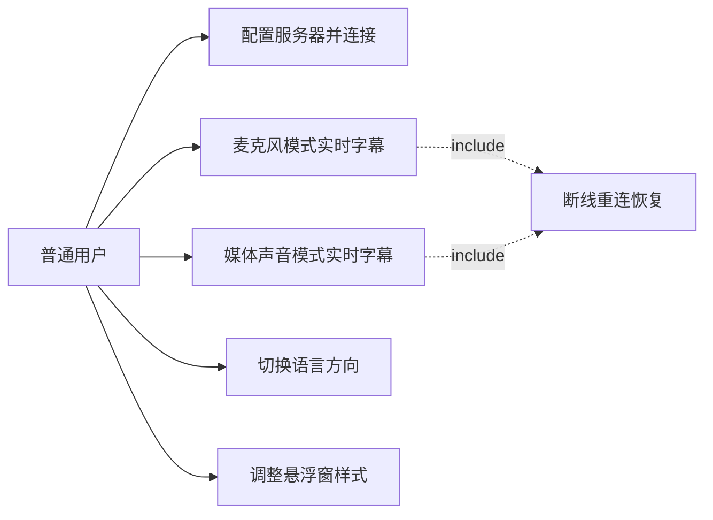

# 需求规格说明书（SRS）

| 项目 | 内容 |
|---|---|
| 项目名称 | 实时双语字幕系统（Realtime Bilingual Subtitle） |
| 文档版本 | v1.0 初稿 |
| 日期 | 2026-09-14 |
| 状态 | 待评审 |

## 1. 引言

### 1.1 编写目的

本文档定义实时双语字幕系统的功能需求、非功能需求、约束与验收标准，作为《02-系统架构设计》《03-接口与通信协议设计》《04-开发计划与任务分解》以及后续编码、测试和课程验收的依据。

### 1.2 项目背景

AI 实时字幕翻译并非空白领域：哔哩哔哩的 AI 字幕、讯飞听见、华为鸿蒙高版本均已实现实时的语音转写与翻译，说明该能力在商业产品中已经成熟。但观察现有产品可以发现两点不足：其一，多为闭源商业服务，功能形态受厂商限制，难以按需定制或集成进自有系统；其二，也是最关键的一点——音频需要上传至厂商云端处理，这对有保密要求的场景构成隐患。例如企业线上会议、涉密沟通中，音频一旦离开内网即存在泄露风险。

因此本项目以**隐私**为切入点：设计一个开源、可自托管（self-hosted）的实时双语字幕系统供企业或个人开发者使用。移动端采集的音频仅经局域网发送到自有的处理主机；基础版仅将识别出的文本送往云端翻译；扩展为本地模型后，音频与文本均不出内网。企业可将其部署于公司自有服务器，员工的手机作为客户端，满足保密会议等场景的合规要求。该企业场景作为项目**愿景**与扩展方向，不纳入本次课程项目的交付目标。

本项目课程版采用"手机采集音频 → 主机智能处理 → 手机悬浮窗显示字幕"的架构：手机抓取媒体声音或麦克风声音，经局域网传给主机，主机使用本地语音识别（faster-whisper）与云端大模型翻译（DeepSeek）处理后回传，手机以悬浮窗形式呈现实时双语字幕。

### 1.3 范围

**基础版（v1.0）包含：**

- Windows 主机服务端（语音识别 + 翻译 + 字幕回传）
- Android 客户端（麦克风采集、媒体声音采集两种模式）
- 局域网通信（WebSocket）
- faster-whisper 语音识别（CUDA 加速）
- DeepSeek API 翻译，基础方向英→中
- 悬浮窗双语字幕显示

**不包含（列入扩展计划，按优先级从高到低排列）：**

| 编号 | 扩展项 | 优先级 |
|---|---|---|
| E1 | 互联网连接（公网访问） | 1 |
| E2 | 翻译使用本地部署模型（隐私目标：音频与文本全链路不出内网） | 2 |
| E3 | 主机支持 Linux | 3 |
| E4 | 移动端支持 iOS、鸿蒙 | 4 |
| S1 | 中日互译等语言扩展 | 远期探索 |

**项目愿景**：作为开源软件，供企业或个人部署于自有服务器并配合本地模型使用，使涉密场景（如保密会议）获得实时双语字幕；本愿景依托 E2/E3 扩展实现，不构成本次课程项目的验收目标。

### 1.4 术语表

| 术语 | 说明 |
|---|---|
| ASR | 自动语音识别（Automatic Speech Recognition），将音频转写为文本 |
| VAD | 语音活动检测（Voice Activity Detection），判断音频中是否有语音 |
| LLM | 大语言模型（Large Language Model），本项目用于翻译 |
| 悬浮窗 | 悬浮于其他应用界面之上的系统级浮层窗口 |
| MediaProjection | Android 屏幕/音频投影 API，媒体声音采集依赖它获得用户授权 |
| 端到端延迟 | 一句话结束（人说完）到该句字幕上屏的时间间隔 |
| 断句 | 依据静音间隔把连续语音流切成句子的过程 |

### 1.5 参考资料

- 本系列文档《02-系统架构设计》《03-接口与通信协议设计》《04-开发计划与任务分解》
- OpenAI 兼容 Chat Completions 接口规范（DeepSeek 遵循）
- Android AudioPlaybackCapture API 官方文档

## 2. 总体描述

### 2.1 产品定位

一款开源、可自托管的实时字幕工具：手机负责"听"（音频采集与上传），主机负责"想"（识别与翻译），手机悬浮窗负责"显示"（双语字幕）。基础版面向个人外语内容观看场景；同时以"音频不出内网、模型可本地化"的架构为企业保密场景（如线上会议）预留移植能力——后者为项目愿景，不纳入本次课程交付目标。

### 2.2 系统上下文

### 2.3 用户特征

唯一角色：**普通用户**。无需技术背景，能完成手机权限授权、连接同一 Wi-Fi、输入服务器地址等基础操作即可使用。企业愿景下该角色对应"使用公司自建服务端的员工"，操作方式不变。

## 3. 功能需求

### 3.1 用例

| 编号 | 用例 | 简述 |
|---|---|---|
| UC-01 | 配置服务器并连接 | 输入主机局域网 IP:端口，建立连接并显示连接状态 |
| UC-02 | 麦克风模式实时字幕 | 采集麦克风声音，实时显示双语字幕 |
| UC-03 | 媒体声音模式实时字幕 | 采集其他 App 播放的声音，悬浮窗叠加显示字幕 |
| UC-04 | 切换语言方向 | 设置源语言与目标语言 |
| UC-05 | 调整悬浮窗样式 | 拖动位置、调节透明度、关闭悬浮窗 |
| UC-06 | 断线重连恢复 | 网络中断后自动重连并恢复会话 |

### 3.2 功能需求清单

优先级：B=基础版（v1.0 必须），E=扩展，S=远期探索。

| 编号 | 功能需求 | 优先级 |
|---|---|---|
| FR-01 | 麦克风采集：采集设备麦克风声音，输出 16kHz 单声道 16bit PCM | B |
| FR-02 | 媒体声音采集：通过 AudioPlaybackCapture（Android 10+）采集其他 App 播放的声音 | B |
| FR-03 | 音频流式上传：按 100ms 分块、带序号，经 WebSocket 上传至服务端 | B |
| FR-04 | 局域网连接：App 内配置服务器 IP:端口，通过 ws 连接，显示连接状态 | B |
| FR-05 | 服务端断句：VAD 检测到静音 ≥500ms 或句长达到 15s 时切句 | B |
| FR-06 | 服务端识别：faster-whisper 将整句音频转写为文本 | B |
| FR-07 | 服务端翻译：调用 DeepSeek 将英文转写翻译为中文 | B |
| FR-08 | 双语字幕悬浮窗：悬浮于其他 App 之上，两行显示原文与译文，支持拖动、透明度调节、关闭 | B |
| FR-09 | 会话控制：开始/停止采集、切换采集模式、断开连接 | B |
| FR-10 | 语言方向配置：App 端配置源/目标语言；v1.0 支持 en→zh，协议层预留 zh→en 及后续新增语言对（含 ja↔zh） | B |
| FR-11 | 断线重连：网络中断后自动重连并恢复会话，字幕按句幂等不重复显示 | B |
| FR-12 | 状态与错误提示：连接状态、采集状态、翻译失败等均有明确提示 | B |
| FR-13 | 互联网连接：支持公网/WAN 场景（wss + 内网穿透或云部署） | E1 |
| FR-14 | 本地模型翻译：本地 LLM（如 Ollama）作为翻译后端，实现音频与文本全链路不出内网 | E2 |
| FR-15 | Linux 主机：服务端可运行于 Linux | E3 |
| FR-16 | iOS / 鸿蒙客户端 | E4 |
| FR-17 | 语言扩展：双语字幕可扩展到英中之外的语言对，以中日互译（ja↔zh）作为扩展演示 | S |

## 4. 非功能需求

| 编号 | 类别 | 指标 | 验证方式 |
|---|---|---|---|
| NFR-01 | 性能-延迟 | 句末→字幕上屏 P95 ≤ 3s；预算：采集缓冲 100ms + 断句等待 ≤500ms + ASR ≤800ms + 翻译 ≤1500ms | 延迟统计报告 |
| NFR-02 | 性能-带宽 | 音频上传 ≈32KB/s（16kHz×16bit 单声道），局域网内无压力 | 实测 |
| NFR-03 | 准确性 | 英文标准口音音频（TED 风格语料）识别 WER ≤ 10%；翻译语义正确率抽检 ≥ 95% | 语料测试 |
| NFR-04 | 稳定性 | 连续运行 ≥30 分钟无崩溃；断线后 30s 内自动恢复 | 系统测试 |
| NFR-05 | 资源 | 主机 GPU 显存占用 ≤6GB（RTX 4060 8GB）；手机端可后台持续采集 | 实测 |
| NFR-06 | 兼容性 | Android 10+；Windows 10/11 | 兼容测试 |
| NFR-07 | 安全性 | API 密钥仅存服务端，不进入客户端、仓库或日志 | 代码审查 |
| NFR-08 | 易用性 | 新用户 3 分钟内完成首次连接并看到字幕 | 演示验证 |
| NFR-09 | 可扩展性 | 语言方向、whisper 模型、翻译后端均为配置项；通信协议版本化 | 设计审查 |
| NFR-10 | 成本 | 单句翻译 token 用量可控，课程演示用量处于免费额度内 | 用量统计 |
| NFR-11 | 隐私性 | 基础版：音频仅经局域网传输，对外仅发送转写文本；E2 扩展后全链路数据不出内网 | 设计审查 |

## 5. 约束与假设

| 编号 | 约束/假设 | 说明 |
|---|---|---|
| C-01 | 运行环境 | 演示时手机与主机处于同一局域网（E1 扩展解除该约束） |
| C-02 | 设备要求 | 媒体声音模式硬性要求 Android 10+；麦克风模式无此限制 |
| C-03 | 主机环境 | Windows + NVIDIA GPU（开发机为 RTX 4060 8GB，CUDA 12.4） |
| C-04 | 外部依赖 | DeepSeek API 可用且额度充足 |
| C-05 | 并发规模 | v1.0 仅支持单客户端；多客户端为后续扩展 |
| A-01 | 捕获限制 | 假设媒体声音模式的目标 App 允许音频捕获（部分 App/DRM 内容禁止） |
| A-02 | 网络互通 | 假设手机 Wi-Fi 与主机网络互通（路由器未开启 AP 隔离） |

## 6. 验收标准

| 编号 | 验收标准 |
|---|---|
| FR-01 | 连接后讲话，服务端收到连续 PCM 数据且无静音截断 |
| FR-02 | 手机播放视频（如 YouTube），字幕随视频语音出现 |
| FR-03 | 服务端按 seq 顺序接收帧，丢帧情况被记录且不影响整句处理 |
| FR-04 | 输入主机局域网 IP 后 3 次连接成功率 100% |
| FR-05/06 | 离线标准音频回放，切句边界与人工标注误差 ≤±300ms，转写文本可读 |
| FR-07 | 100 句英文转写抽检，译文语义正确率 ≥95% |
| FR-08 | 悬浮窗在其他 App 之上可见、可拖动，两行双语正常显示 |
| FR-10 | en→zh 方向全链路可用；zh→en 及后续新增语言对在协议层可配置（v1.0 不要求全链路） |
| FR-11 | 断网/服务端重启后 30s 内自动恢复，已显示字幕不重复 |
| FR-12 | 无网络、翻译失败等场景均有明确提示；翻译失败时降级回传原文 |

## 7. 需求追溯矩阵

| 功能需求 | 架构对应（02 文档） | 协议对应（03 文档） | 测试对应（04 文档） |
|---|---|---|---|
| FR-01 麦克风采集 | §5.2 MicSource | §3 音频帧 | 单元+系统 |
| FR-02 媒体声音采集 | §5.2 MediaSource | §3 音频帧 | 系统 |
| FR-03 流式上传 | §5.2 网络层 | §3 音频帧格式 | 集成 |
| FR-04 局域网连接 | §8 部署视图 | §2 连接与握手 | 系统 |
| FR-05 断句 | §4.2 断句器 | §9.3 VAD 参数 | 单元 |
| FR-06 识别 | §4.2 ASR 引擎 | §9.1 ASR 抽象 | 集成 |
| FR-07 翻译 | §4.2 翻译服务 | §9.2/§10 | 集成 |
| FR-08 悬浮窗 | §5.2 悬浮窗 | §5 subtitle 消息 | 系统 |
| FR-09 会话控制 | §5.2 控制页 | §4 控制消息 | 系统 |
| FR-10 语言方向 | §4.2 会话配置 | §8 语言枚举 | 集成 |
| FR-11 断线重连 | §4.4 会话与重连 | §7 断线重连 | 系统 |
| FR-12 错误提示 | §11 错误处理 | §6 错误码 | 系统 |
| FR-13~16 扩展项 | §9 扩展预留设计 | 复用现有协议 | 按扩展计划 |

## 8. 变更记录

| 版本 | 日期 | 说明 |
|---|---|---|
| v1.0 初稿 | 2026-09-14 | 确立基础版范围、四项扩展优先级与远期探索项（中日互译） |
| v1.1 | 2026-09-14 | 修正项目背景事实性表述（承认现有商业产品已具备实时字幕能力）；确立"隐私驱动 + 企业自托管"愿景定位；新增 NFR-11 隐私性 |
| v1.2 | 2026-09-14 | §1.2 背景与 §1.3 愿景补充"可供个人开发者使用"；S1 由"中日互译"改为"语言扩展（以中日互译演示）"，并同步 FR-17、FR-10 验收标准及 02/03/04 的联动表述 |
