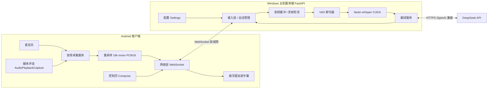
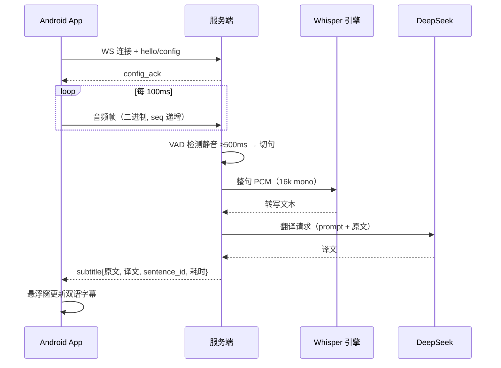

# 系统架构设计说明书

| 项目 | 内容 |
|---|---|
| 项目名称 | 实时双语字幕系统 |
| 文档版本 | v1.0 初稿 |
| 日期 | 2026-09-14 |
| 依据 | 《01-需求规格说明书》 |

## 1. 引言

本文档描述系统的总体架构、模块划分、关键技术选型与设计决策、部署方案，以及为四项扩展（互联网连接、本地模型翻译、Linux 主机、iOS/鸿蒙客户端）预留的设计点。

## 2. 总体架构

系统采用客户端-服务器（C/S）架构 + 服务端内部管道（Pipeline）模式。手机只承担采集、传输与显示职责；全部智能计算（断句、识别、翻译）位于主机；翻译能力由云端大模型 API 提供。



### 2.1 一次完整的数据流



## 3. 架构原则

1. **管道解耦**：断句、识别、翻译为独立阶段，以队列衔接，任一阶段失败不拖垮整体。
2. **一切可变项配置化**：语言方向、whisper 模型、翻译后端、端口均为配置项。
3. **协议版本化**：通信协议带版本号，向后兼容演进。
4. **为扩展预留抽象边界**：翻译后端（Translator）、音频源（AudioSource）、传输层（ws/wss）均为可替换接口。
5. **数据最小外传**：音频仅在局域网内传输；对外仅发送识别后的文本；本地模型扩展（E2）后实现零外传，支撑企业保密场景。

## 4. 服务端设计

### 4.1 进程与并发模型

- 单进程 asyncio：FastAPI + uvicorn 承载 WebSocket 接入。
- 每个 WebSocket 连接对应一个会话（Session），会话间状态隔离。
- **ASR 串行队列**：GPU 推理独占模型实例，多句排队依次识别。
- **翻译并发受限**：httpx 异步客户端，并发上限 3，失败重试 2 次。
- VAD 为 CPU 轻量推理（onnxruntime），不占用 GPU。

### 4.2 模块划分

| 模块 | 职责 | 关键依赖 |
|---|---|---|
| connection | WebSocket 接入、握手校验、会话注册、重连恢复 | fastapi |
| audio_buffer | 帧排序（seq）、丢帧统计、当前句缓存 | — |
| segmenter | Silero VAD 切句，输出整句 PCM | silero-vad, onnxruntime |
| asr_engine | faster-whisper 封装：模型加载、串行队列、耗时统计 | faster-whisper |
| translator | 翻译抽象接口 + DeepSeek 实现（重试、超时、降级） | httpx |
| session | 会话状态：配置、sentence_id 分配、统计、TTL | — |
| settings | 环境变量 / config.yaml 配置加载与校验 | pydantic-settings |
| telemetry | 结构化日志、各环节耗时统计 | logging/structlog |

### 4.3 服务端处理管道

```
音频帧 ──▶ 音频缓冲 ──▶ VAD 断句 ──▶ ASR 队列 ──▶ 翻译队列 ──▶ subtitle 回传
              │(丢帧统计)   (静音500ms/句长15s)  (串行,GPU)   (并发3,重试2)
              └─────────────── 降级路径：ASR/翻译失败 → 丢弃该句或回传原文 + error 通知
```

### 4.4 会话与重连

- 客户端生成 UUID 作为 `session_id`，连接时携带。
- 服务端在内存中保留会话状态 30s（可配），断线期间未完成的半句作废。
- `sentence_id` 会话内单调递增，客户端按 id 去重，保证重连后字幕幂等显示。

## 5. 客户端设计（Android）

### 5.1 技术栈与工程基线

| 项 | 选型 |
|---|---|
| 语言 | Kotlin |
| 最低/目标版本 | minSdk 29（Android 10）/ targetSdk 34 |
| UI | Jetpack Compose（控制页） |
| 网络 | OkHttp WebSocket |
| 本地配置 | DataStore |
| 后台运行 | 前台服务（Foreground Service） |

### 5.2 模块划分

| 模块 | 职责 |
|---|---|
| ui | 控制页：服务器地址、采集模式、语言方向、开始/停止、状态与日志 |
| capture | `AudioSource` 接口（策略模式）；`MicSource`（AudioRecord）、`MediaSource`（MediaProjection + AudioPlaybackCapture） |
| resample | 将音频源原始格式统一重采样为 16kHz 单声道 16bit PCM |
| net | `WsClient`：握手、音频帧封装（seq 递增）、指数退避重连 |
| overlay | 悬浮窗：WindowManager 浮层，双语两行，拖动/透明度/关闭 |
| permissions | 权限引导流程（见 5.3） |

### 5.3 权限与授权流程

| 权限 | 用途 | 获取时机 |
|---|---|---|
| RECORD_AUDIO | 麦克风模式采集 | 首次选择麦克风模式时运行时申请 |
| MediaProjection | 媒体声音捕获（系统授权） | 每次启动媒体模式时系统弹窗确认 |
| SYSTEM_ALERT_WINDOW | 悬浮窗显示 | 首次开启字幕时引导至系统设置页 |
| FOREGROUND_SERVICE（+MICROPHONE/MEDIA_PROJECTION） | 后台持续采集 | 开始采集时 |
| POST_NOTIFICATIONS（Android 13+） | 前台服务通知 | 运行时申请 |

授权流程：用户在控制页选择采集模式 → 权限引导逐项完成 → 开始采集 → 提示"可切至其他 App，字幕将悬浮显示"。

### 5.4 前台服务与悬浮窗生命周期

- 采集运行于前台服务，退出 App 不中断；悬浮窗由前台服务管理，与控制页生命周期解耦。
- 停止采集时释放 MediaProjection 与 AudioRecord，悬浮窗可选择保留最近字幕。

## 6. 技术选型汇总

| 层 | 选型 | 版本/说明 | 理由 |
|---|---|---|---|
| 服务端框架 | FastAPI + uvicorn | Python 3.10 | async WebSocket 成熟，文档完善 |
| ASR | faster-whisper | medium（默认，可配 small/large-v3） | whisper 生态中推理速度最优（CTranslate2），支持 CUDA 与 int8 |
| VAD | silero-vad | v5, onnxruntime | 轻量、离线、无额外训练 |
| 翻译 | DeepSeek（deepseek-chat） | OpenAI 兼容接口 | 国内直连、成本低、质量满足字幕需求 |
| 移动网络 | OkHttp WebSocket | 4.x | 稳定成熟，重连控制灵活 |
| 客户端 UI | Jetpack Compose | — | 声明式 UI，开发效率高 |
| 通信协议 | WebSocket + JSON 控制消息 + 二进制音频帧 | 见 03 文档 | 全双工低延迟、易调试、易版本化 |

## 7. 关键设计决策（ADR）

### ADR-01 按句翻译，不做逐字流式

- **选项**：A. 流式逐词识别、逐句重译（延迟低但译文反复抖动）；B. 按句处理（VAD 断句后整句识别+翻译，译文稳定，延迟 1~3s）。
- **决策**：B。字幕场景下句子级延迟可接受，译文质量优先；协议预留 `partial` 中间结果消息（v1.1）作为折中。
- **后果**：端到端延迟预算 ≤3s；无需流式纠错逻辑，复杂度显著降低。

### ADR-02 传输选 WebSocket，而非 WebRTC 或 HTTP 分块上传

- **选项**：WebRTC（延迟最低但信令与 NAT 复杂）、HTTP chunk（单向，控制消息别扭）、WebSocket（全双工、简单）。
- **决策**：WebSocket。局域网内无 NAT 穿透需求；互联网扩展（E1）仅需换 wss + 隧道/云部署，协议不变。
- **后果**：音频以 100ms 块推送，整体延迟受块大小影响可忽略。

### ADR-03 whisper 默认 medium 模型（配置项可调）

- **依据**：开发机 RTX 4060 8GB。medium 在 4060 上实时率约 5~10 倍，英文转写精度满足字幕需求；small 更快但精度下降；large-v3 精度最高但显存与单句延迟上升。
- **决策**：默认 medium + CUDA fp16；`WHISPER_MODEL` 配置项允许切换，CPU 环境自动降级 int8。
- **后果**：识别延迟 ≤800ms/句 的预算成立；后续扩展本地/云端环境可按需调整。

### ADR-04 翻译后端 OpenAI 兼容抽象

- **决策**：定义 `Translator` 接口（translate(text, src_lang, tgt_lang)），实现基于 OpenAI 兼容 Chat Completions；base_url/api_key/model 全部配置化。
- **收益**：DeepSeek ↔ 其他厂商 ↔ 本地 Ollama（E2）零代码切换。

### ADR-05 字幕显示采用悬浮窗，而非系统字幕通道或画中画

- **决策**：WindowManager 悬浮窗。系统字幕通道依赖无障碍/系统接口不可通用；画中画不支持叠加在其他 App 上。悬浮窗通用、样式可控。

### ADR-06 统一音频规格 16kHz / 单声道 / PCM16

- **决策**：客户端完成重采样，上传固定 16kHz mono PCM16。
- **理由**：whisper 输入标准；带宽仅 32KB/s；服务端零转换逻辑。

### ADR-07 v1.0 单客户端，但按会话隔离设计

- **决策**：v1.0 只服务一个客户端（课程演示场景），但服务端状态全部挂在会话（Session）对象上，多客户端扩展只需增加调度队列，无需重构。

## 8. 部署视图


- **端口**：默认 8000（可配），仅监听 0.0.0.0 供局域网访问。
- **Windows 防火墙**：首次运行时需允许 Python 通过防火墙（文档将提供放行步骤）；联调前先做连通性检查。
- **获取主机 IP**：`ipconfig` 查看无线网卡 IPv4 地址；客户端填入该地址即可。
- **可选**：手机热点直连主机作为演示备选（网络不稳时更可控）。

## 9. 扩展预留设计（对应 E1~E4、S1）

| 扩展 | 预留设计 | 预计改动 |
|---|---|---|
| E1 互联网连接 | 协议不变；传输层换 wss（TLS 由 frp/ngrok/云服务器终结）；客户端地址已支持 ws/wss | 部署与文档，代码改动极小 |
| E2 本地模型翻译 | `Translator` 新增 Ollama 实现（base_url 指向本地 11434）；隐私动机：全链路数据不出内网，支撑企业保密场景 | 新增一个实现类 + 配置项 |
| E3 Linux 主机 | 全部依赖跨平台（faster-whisper/silero-vad/onnxruntime 均有 Linux 版） | requirements 与启动脚本，无架构改动 |
| E4 iOS / 鸿蒙 | 服务端与协议完全复用；iOS 仅支持麦克风模式（系统级媒体捕获受平台限制）；鸿蒙需原生重写采集层 | 独立客户端工程，协议文档即接口契约 |
| S1 语言扩展（以中日互译演示） | 语言方向是配置项，协议语言枚举已含 ja（见 03 文档 §8），翻译接口按 src→tgt 抽象 | 新增语言对只需扩充枚举与语言名映射、补充对应 prompt 模板与测试语料，管道本身无需改动 |

## 10. 安全设计

- API 密钥仅存服务端环境变量 / .env（加入 .gitignore），不进入客户端、仓库或日志。
- v1.0 局域网内使用明文 ws，作为演示环境可接受；协议预留 token 鉴权与 wss（v2.0）。
- 服务端对音频帧长度、句长上限做校验，防止异常输入导致内存膨胀。
- 数据流隐私边界：基础版中音频仅在局域网内传输，发送至 DeepSeek 的仅为转写文本；E2 扩展后音频与文本均不出内网，满足保密场景要求。

## 11. 错误处理与可观测性

| 场景 | 处理 |
|---|---|
| 音频帧格式错误 | 忽略并计数，连续 10 帧非法回 error 2001 |
| ASR 失败 | 丢弃该句，回 error 3001（recoverable），连接不断 |
| 翻译失败/超时 | 降级回传原文（translation=source 并标记），回 error 4001/4002 |
| 服务器繁忙（队列积压） | 丢弃最旧句子，回 error 5001 |
| 客户端断线 | 会话保留 30s，等待同 session_id 重连 |

服务端日志记录：session_id、sentence_id、各阶段耗时（断句/识别/翻译/总延迟），支撑 NFR-01 的延迟验收；客户端以 Toast/状态栏提示错误码对应文案。

## 12. 代码目录规划

```
bilingual-subtitle/
├── docs/                    # 01-04 设计文档
├── server/                  # Python 服务端
│   ├── app/
│   │   ├── main.py          # FastAPI 入口
│   │   ├── connection.py    # WebSocket 接入与握手
│   │   ├── buffer.py        # 音频缓冲与丢帧统计
│   │   ├── segmenter.py     # VAD 断句
│   │   ├── asr.py           # faster-whisper 封装
│   │   ├── translate.py     # Translator 抽象 + DeepSeek 实现
│   │   ├── session.py       # 会话状态
│   │   └── settings.py      # 配置加载
│   ├── tests/               # 单元/集成测试
│   └── requirements.txt
├── android/                 # Android 工程（Gradle + Kotlin）
├── scripts/                 # 模拟客户端、离线音频端到端测试、延迟统计
└── README.md
```

## 13. 变更记录

| 版本 | 日期 | 说明 |
|---|---|---|
| v1.0 初稿 | 2026-09-14 | 初稿：总体架构、服务端/客户端设计、7 项 ADR、扩展预留 |
| v1.1 | 2026-09-14 | 新增架构原则"数据最小外传"；补充数据流隐私边界与企业自托管扩展的隐私动机 |
| v1.2 | 2026-09-14 | S1 由"中日互译"改为"语言扩展"能力表述，与 01 文档同步 |
