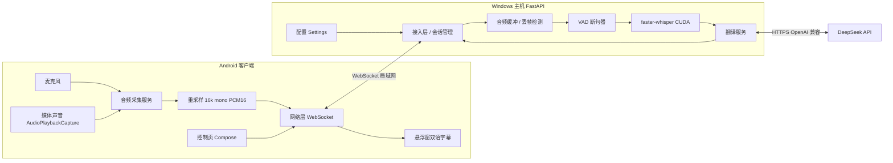
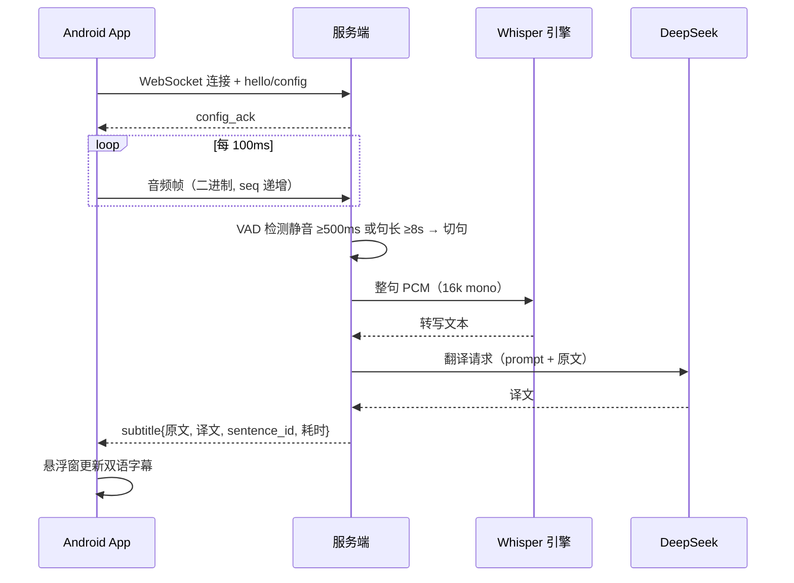

# 实时双语字幕系统

## 软件工程课程报告

| 项目 | 内容 |
|---|---|
| 课程 | 软件工程 |
| 学生姓名 | （请填写） |
| 学号 | （请填写） |
| 班级 | （请填写） |
| 指导教师 | （请填写） |
| 完成日期 | 2026-10-19 |
| 代码仓库 | <https://github.com/Sloughel/realtime-bilingual-subtitle> |
| 报告版本 | v1.0 |

---

## 摘要

商业实时字幕产品（如视频平台的 AI 字幕、会议软件的实时翻译）已经成熟，但普遍是闭源服务，且需要把音频上传到厂商云端。对于会议、访谈、内部培训等对保密性有要求的场景，音频离开私有网络本身就是风险。本项目以**隐私**为切入点，设计并实现一个开源、可自托管的实时双语字幕系统：Android 手机负责采集麦克风或媒体播放声音，经局域网把音频送到自有主机；主机用 Silero VAD 断句、faster-whisper 做语音识别、DeepSeek 做机器翻译；手机以系统悬浮窗在其他应用之上显示原文与译文两行字幕。

系统采用「客户端—服务端 + 服务端内部管道」架构，定义了带版本号的双向 WebSocket 协议（二进制音频帧 + JSON 控制/字幕消息），实现了双采集模式、断线自动重连、翻译失败降级、悬浮窗交互、配置化部署与自检工具。测试方面，服务端 50 项单元/集成测试全部通过，离线端到端测试 8 句全部正确；Redmi Pad SE 真机完成媒体声音、麦克风、悬浮窗、后台保活、断线重连、停止冲刷六项验证；M3 最终 83 句真实场景数据端到端延迟 **P50 1886ms、P95 2475ms**，满足 P95 ≤ 3s 的非功能目标；100 句翻译人工复看 100/100 通过。报告同时如实记录了未达到严格验收口径的部分：识别 WER 语料仅 17.3 秒、翻译评审为单人而非双人独立评审、未做抓包与第三方部署演练等。

本项目的工程价值不仅在于一个可运行的系统，更在于一套**可复现、可核对、可交接**的研制过程：需求、架构、协议、计划、测试数据与 AI 协作记录全部入库，关键性能数字均有原始 JSON/CSV 证据，关键缺陷均记录了「现象—根因—修复—回归」的完整链路。

**关键词**：实时字幕；语音识别；机器翻译；WebSocket；Android；faster-whisper；隐私计算；AI 辅助软件工程

---

## 1 引言

### 1.1 背景与问题

实时语音转写与翻译并非空白领域。视频平台的 AI 字幕、讯飞听见、部分手机系统的实时字幕都已证明这项能力在商业产品中可行。但观察现有产品可以看到两个不足：

1. **闭源、形态受限**：功能由厂商定义，难以按需修改，也难以集成进自有系统；
2. **音频必须上云**：识别与翻译在厂商服务器完成，音频一旦离开内网就存在泄露风险。

对于企业线上会议、涉密沟通、内部培训等场景，「把会议音频交给第三方云服务」往往直接不可接受。因此，本项目把问题重新定义为：

> 能否用一台普通 PC 和一部 Android 手机，搭起一套**音频只在私有网络内流动、软件完全可控、可自行部署**的实时双语字幕系统？

### 1.2 项目定位与目标

本项目的定位是**开源、可自托管的实时字幕工具**：手机负责「听」，主机负责「想」，手机悬浮窗负责「显示」。基础版面向个人观看外语视频的场景；同时以「音频不出内网、模型可本地化」的架构为企业保密场景预留移植能力。后者是项目愿景与扩展方向，不作为本次课程交付的验收目标。

课程版的具体目标：

| 编号 | 目标 | 完成情况 |
|---|---|---|
| G1 | Windows 主机 + Android 客户端，局域网内端到端跑通 | 已完成 |
| G2 | 麦克风与媒体播放声音两种采集模式 | 已完成（Redmi Pad SE 验证） |
| G3 | 悬浮窗实时显示双语字幕，可拖动、调透明度、关闭 | 已完成 |
| G4 | 端到端延迟 P95 ≤ 3s | 已完成（P95 2475ms） |
| G5 | 断线重连、翻译失败降级、错误可见 | 已完成 |
| G6 | 部署、配置、自检、排障有文档与工具 | 已完成 |
| G7 | 扩展项（公网、本地模型、Linux、iOS/鸿蒙、语言扩展） | **未实施**，仅预留设计边界 |

### 1.3 交付物与报告组织

本次交付包括：

| 交付物 | 位置 |
|---|---|
| 代码仓库 | GitHub `Sloughel/realtime-bilingual-subtitle`（public） |
| 需求规格 | [`01-需求规格说明书.md`](01-需求规格说明书.md) |
| 架构设计 | [`02-系统架构设计.md`](02-系统架构设计.md) |
| 接口与协议 | [`03-接口与通信协议设计.md`](03-接口与通信协议设计.md) |
| 开发计划与完成记录 | [`04-开发计划与任务分解.md`](04-开发计划与任务分解.md) |
| 项目状态与交接 | [`05-项目状态与交接说明.md`](05-项目状态与交接说明.md) |
| 翻译质量评审记录 | [`06-NFR03-翻译评审记录.md`](06-NFR03-翻译评审记录.md) |
| 课程报告（本文） | [`07-课程报告.md`](07-课程报告.md) |
| 演示与答辩脚本 | [`08-演示与答辩脚本.md`](08-演示与答辩脚本.md) |
| AI 协作记录 | [`AI协作记录.md`](AI协作记录.md) |
| 演示视频 | 由学生按脚本录制，随课程提交（不在仓库内） |

报告按「需求 → 设计 → 实现 → 测试 → 人机协作 → 总结」组织。为使报告可独立阅读，正文复述了关键设计结论；更细的字段级定义仍以 01~03 文档为唯一权威。

---

## 2 需求分析

### 2.1 用户角色与用例

系统面向三类角色：

| 角色 | 说明 | 核心诉求 |
|---|---|---|
| 终端用户 | 使用 Android 客户端看字幕 | 连接简单、字幕及时、可覆盖在其他应用上 |
| 部署者 | 在自有主机上部署与维护服务端 | 配置集中、部署可复现、故障能自诊断 |
| 二次开发者 | 阅读/修改源码、扩展语言或接入自有系统 | 协议清晰、模块解耦、扩展点明确 |

课程项目主要交付前两类角色的完整能力；第三类角色只做到「架构预留 + 文档完备」，贡献指南等开放性工作未实施。

主要用例：

| 编号 | 角色 | 用例 | 结果 |
|---|---|---|---|
| UC-01 | 终端用户 | 配置服务器并连接 | 输入主机 IP:端口，建立连接并显示状态 |
| UC-02 | 终端用户 | 麦克风模式实时字幕 | 采集现场声音，悬浮窗显示双语字幕 |
| UC-03 | 终端用户 | 媒体声音模式实时字幕 | 采集其他 App 播放的声音 |
| UC-04 | 终端用户 | 切换语言方向 | v1.0 为 en→zh，协议预留其他方向 |
| UC-05 | 终端用户 | 调整悬浮窗样式 | 拖动、透明度、关闭与重新打开 |
| UC-06 | 终端用户 | 断线重连恢复 | 网络恢复后自动续传，已出字幕不重复 |
| UC-07 | 部署者 | 部署服务端 | 安装依赖、获取模型、配置并启动 |
| UC-08 | 部署者 | 配置模型与翻译后端 | 模型规格、API 端点/密钥、断句参数、端口 |
| UC-09 | 部署者 | 部署自检与排障 | 运行自检工具定位依赖、CUDA、配置问题 |

### 2.2 功能需求

功能需求共 21 条（FR-01~FR-21），按「采集—传输—处理—显示—部署」分组：

| 组 | 需求 | 验收要点 | 状态 |
|---|---|---|---|
| 采集 | FR-01 麦克风采集 | 16kHz 单声道 PCM16 | 通过 |
| 采集 | FR-02 媒体声音采集 | Android 10+，捕获其他 App 声音 | Redmi 通过；华为 ROM 不支持 |
| 传输 | FR-03 流式上传 | 100ms 分块、seq 递增、丢帧可检测 | 通过 |
| 传输 | FR-04 局域网连接 | App 内配置 IP:端口，ws 连接 | 通过 |
| 处理 | FR-05 VAD 断句 | 静音 ≥500ms 或句长 ≥8s 切句 | 通过（8s 为 M3 调优结果） |
| 处理 | FR-06 语音识别 | faster-whisper 整句转写 | 通过 |
| 处理 | FR-07 翻译 | DeepSeek 英→中 | 通过 |
| 显示 | FR-08 双语悬浮窗 | 两行、可拖动、透明度、关闭 | 通过 |
| 控制 | FR-09 会话控制 | 开始/停止/切换模式/断开 | 通过（含采集热切换） |
| 配置 | FR-10 语言方向 | en→zh；协议预留 zh→en/ja | 部分：仅 en→zh 全链路 |
| 可靠 | FR-11 断线重连 | ≤30s 自动恢复，字幕幂等 | 通过（自动恢复；未精确计时） |
| 提示 | FR-12 状态与错误提示 | 连接/采集/翻译失败均可见 | 通过 |
| 扩展 | FR-13~FR-17 | 公网、本地模型、Linux、iOS/鸿蒙、语言扩展 | **未实施**（E1~E4/S1） |
| 部署 | FR-18 部署与启动 | 依赖清单、配置模板、启动方式 | 通过 |
| 配置 | FR-19 配置管理 | 模型/后端/断句/端口集中配置 | 通过 |
| 自检 | FR-20 部署自检 | 检查依赖、CUDA、配置并给提示 | 通过 |
| 成本 | FR-21 成本监控 | 累计 token/费用，阈值通知一次 | 通过 |

### 2.3 非功能需求

| 编号 | 指标 | 验收口径 | 本次结论 |
|---|---|---|---|
| NFR-01 | 延迟 | 句末→上屏 P95 ≤3s（100 句样本） | **通过（近似）**：83 句 P95 2475ms；判据要求 100 句，样本规模略低（见 §5.8） |
| NFR-02 | 带宽 | 上行音频 ≤40KB/s | 按协议规格 32.06KB/s，满足；未抓包实测 |
| NFR-03 | 准确性 | WER ≤10%（100 句/≥10min）；翻译语义正确率 ≥95%（双人评审） | **部分达标**：WER 语料仅 17.3s；翻译为单人复看 100/100 |
| NFR-04 | 稳定性 | 连续 ≥30min 无崩溃/内存增长；断线 ≤30s 恢复 | **通过**：30 分钟 330 句、0 错误、RSS 无增长（§5.5.4）；自动重连已确认，耗时未精确计时 |
| NFR-05 | 资源 | GPU ≤6GB、空闲 ≤1GB；手机内存增长 ≤100MB/30min | 服务端通过（加载后 2566MB、空闲 904MB）；手机内存曲线未采集 |
| NFR-06 | 兼容性 | Android 10+；Windows 10/11 | Redmi Pad SE（Android 15）通过；华为（Android 16）媒体内录受限 |
| NFR-07 | 安全 | 密钥不得进入客户端、仓库、日志 | 通过（提交前扫描，见 §5.7） |
| NFR-08 | 易用性 | 新用户 ≤3 分钟看到首条字幕 | 未正式计时（非验收重点） |
| NFR-09 | 可扩展性 | 语言/模型/后端配置化，协议版本化 | 设计通过；未用第二种语言对实测 |
| NFR-10 | 成本 | 用量不设上限，达 10 元或 10⁹ tokens 通知一次 | 通过：100 句约 0.026 元，阈值未触发 |
| NFR-11 | 隐私 | 音频仅局域网；对外只发文本 | 设计通过；未做抓包核验 |
| NFR-12 | 可部署性 | 30 分钟内按 README 部署并自检 | 工具齐备；未做第三方独立演练 |

### 2.4 范围、约束与假设

**基础版包含**：Windows 服务端、Android 客户端、局域网 WebSocket、faster-whisper、DeepSeek、悬浮窗。

**不包含**：公网访问（E1）、本地模型翻译（E2）、Linux 主机（E3）、iOS/鸿蒙客户端（E4）、英中之外语言对的全链路（S1）。

**关键约束**：

- C-01：演示时手机与主机处于同一局域网（或同一 ZeroTier 虚拟网络）；
- C-02：媒体声音模式要求 Android 10+，且目标应用允许音频捕获；
- C-03：主机为 Windows + NVIDIA GPU（开发机 RTX 4060 8GB）；
- C-04：DeepSeek API 可用且额度充足；
- C-05：v1.0 只服务单个客户端，但服务端状态按会话隔离，为多客户端预留。

**关键假设**：目标 App 不禁止音频捕获（DRM 内容可能禁止）；路由器未开启 AP 隔离。

### 2.5 需求变更与偏差记录

需求并非一成不变。开发过程中有三处变更对结果影响较大，均已在 01 文档变更记录中留痕：

1. **句长上限由 15s 改为 8s（FR-05）**。M3 首轮 128 句数据显示，长句使 ASR 延迟显著上升（P95 5211ms）。对照实验表明 8s 切分的每秒音频耗时更高，但单句绝对耗时更短、端到端更稳定；学生确认「8 秒切句观感良好」后正式采用。
2. **华为手机媒体内录限制（C-02）**。华为图库、第三方播放器、酷狗音乐均捕获到 0% 电平，判定为 ROM 级限制，不是链路故障。正式演示设备改为 Redmi Pad SE；华为机保留麦克风+外放兜底能力。
3. **翻译评审由双人改为单人（NFR-03 程序偏差）**。学生无法找到第二名评审，改为本人逐句复看 100/100 通过。该偏差如实记录在 06 文档，报告中不将其表述为「双人评审通过」。

这些变更说明：需求文档不是一次性产物，而是随实测证据演进的活文档；但每一次变更都必须写清**触发证据、影响范围与验收口径**。

---

## 3 系统设计

### 3.1 总体架构

系统采用客户端—服务端（C/S）架构，服务端内部为管道（Pipeline）结构。手机只负责采集、传输、显示；所有智能计算在主机完成；翻译由云端大模型 API 提供。



选择这一架构的理由：

- **端侧算力不足**：手机做 whisper 推理的速度与功耗都不可接受；
- **隐私边界清晰**：音频只在私有网络内流动，主机是唯一的数据汇聚点；
- **可替换性强**：识别、翻译、传输三层均为可替换接口，为 E1~E4 预留空间；
- **课程可行性**：单机即可演示，不依赖云服务器与公网。

### 3.2 一次完整的数据流



一条字幕的生命周期可以拆成固定开销与可变开销：

| 阶段 | 典型耗时 | 说明 |
|---|---|---|
| 采集缓冲 | 100ms | 100ms 一帧 |
| 传输 | <20ms | 局域网，可忽略 |
| 断句等待 | 约 500ms | 静音判定；句长达到 8s 时立即切 |
| ASR | 0.4~1.1s | CUDA float16，medium 模型 |
| 翻译 | 0.6~1.1s | DeepSeek API |
| 渲染 | <50ms | 悬浮窗更新 |

预算合计 ≤3s，实测 P95 2475ms（见 §5.5）。

### 3.3 协议设计

协议的唯一权威定义是 03 文档。设计要点：

**传输与握手**。WebSocket 端点 `/ws`，客户端携带 `protocol_version=1` 与 `session_id`。服务端回 `hello`，声明 `max_sentence_ms`、`chunk_ms`、`sample_rate`；客户端再发 `config`，收到 `config_ack` 后才开始送音频。

**音频帧**采用固定 6 字节头 + 3200 字节负载：

| 字段 | 偏移 | 长度 | 说明 |
|---|---|---|---|
| magic | 0 | 1 | 固定 0xAF |
| version | 1 | 1 | 固定 1 |
| seq | 2 | 4 | uint32 大端，从 1 递增 |
| payload | 6 | 3200 | 1600 采样点 = 100ms PCM16 小端 |

帧长固定 3206 字节，便于接收端做长度校验与丢帧统计；`seq` 用于检测网络丢帧；非法帧累计 10 帧才断开，避免偶发损坏导致会话中断。

**控制与字幕消息**为 JSON 文本帧：`config`、`start`、`stop`、`reset`、`ping`，服务端回 `config_ack`、`subtitle`、`error`、`pong`、`status`。`subtitle` 携带 `sentence_id`、`seq_start/seq_end`、`start_ms/end_ms`、`asr_ms/translate_ms`、`translation_degraded`，既是显示数据，也是延迟验收的原始证据。

**错误码**分为协议（1001/1002）、音频（2001）、识别（3001）、翻译（4001/4002）、过载（5001）。原则是「单句错误永不导致连接断开」：识别失败丢弃该句，翻译失败降级回传原文并标记，队列积压丢最旧句。

为什么选 WebSocket 而不是 WebRTC 或 HTTP 分块上传？WebRTC 延迟最低，但信令与 NAT 复杂，局域网场景用不上；HTTP 分块上传是单向的，控制消息与字幕回传都很别扭；WebSocket 全双工、协议简单、浏览器与 OkHttp 都成熟，且未来换 wss 即可支持公网扩展。

### 3.4 服务端设计

服务端为单进程 asyncio：FastAPI + uvicorn 承载 WebSocket；每个连接对应一个 `Session`；ASR 用串行锁独占 GPU；翻译用 httpx 异步客户端，并发上限 3；VAD 用 onnxruntime 在 CPU 上推理，不占 GPU。

| 模块 | 职责 |
|---|---|
| `main.py` | FastAPI 入口、生命周期、模型加载、`/health`、`/status`、`/latency` |
| `settings.py` | pydantic-settings 配置加载与校验 |
| `protocol.py` | 常量、帧编解码、消息构造 |
| `buffer.py` | 帧校验、seq 排序、丢帧统计 |
| `segmenter.py` | Silero VAD 流式断句（自持 LSTM 状态） |
| `asr.py` | faster-whisper 封装、预热、CPU 降级 |
| `translate.py` | `Translator` 抽象 + DeepSeek 实现 + 重试/降级/成本 |
| `session.py` | 会话状态、处理管道、背压、延迟统计 |
| `connection.py` | WebSocket 接入、会话注册、重连 |
| `telemetry.py` | 逐句记录、分位统计 |

**延迟统计口径**是设计中最容易出错的部分。最初用「首帧到达时间 + 标称音频位置」估算句末时刻，实测与客户端观感偏差接近 2 倍。最终改为：每收到一帧就记录「音频位置 → 实际到达墙钟时刻」，句末时用 `end_ms` 查表得到真实到达时刻，再用 `created_ms` 相减。这样统计的是**句末真实上屏延迟**，而不是理想化推算。

**会话与重连**：客户端生成 UUID 作为 `session_id`；服务端保留会话 30s；重连后客户端重发 `config`，已回传的 `subtitle` 不重放，客户端按 `sentence_id` 去重。

### 3.5 客户端设计

客户端为 Kotlin + Jetpack Compose，minSdk 29 / targetSdk 34。采集运行在前台服务中，退出 Activity 不中断；悬浮窗由前台服务管理，与控制页生命周期解耦。

| 模块 | 职责 |
|---|---|
| `ui` | 服务器地址/端口、模式、语言、悬浮窗开关与透明度、开始/停止、状态与日志 |
| `capture` | `AudioSource` 策略接口：`MicSource`、`MediaSource` |
| `resample` | 统一重采样为 16kHz 单声道 PCM16 |
| `net` | `WsClient`：握手、帧封装、心跳、指数退避重连 |
| `overlay` | `WindowManager` 悬浮窗：双语两行、拖动、透明度、关闭 |
| `service` | `CaptureService` 前台服务，持有连接与音源 |

**权限流程**：RECORD_AUDIO（首次麦克风）、MediaProjection（每次媒体模式系统弹窗）、SYSTEM_ALERT_WINDOW（首次悬浮窗跳系统设置）、前台服务类型（麦克风/媒体投影）、POST_NOTIFICATIONS（Android 13+）。

**媒体声音采集**使用 `AudioPlaybackCaptureConfiguration`，只允许捕获 `USAGE_MEDIA/GAME/UNKNOWN`；Android 14 要求先以 `mediaProjection` 类型启动前台服务，再获取投影。部分 OEM 在纯音频捕获时不保持投影会话，因此客户端创建一个 1×1 的 `VirtualDisplay` 作为保活。

### 3.6 关键设计决策

| 编号 | 决策 | 主要理由 | 代价 |
|---|---|---|---|
| ADR-01 | 按句翻译，不做逐字流式 | 译文稳定；字幕场景 1~3s 可接受 | 延迟下限约 0.6s（100ms 缓冲 + 500ms 静音） |
| ADR-02 | WebSocket | 全双工、简单、易版本化 | 公网需 wss + 隧道（E1） |
| ADR-03 | whisper medium + CUDA fp16 | 精度/速度平衡，显存 1.66GB | 首次加载 4s，需预热 |
| ADR-04 | 翻译后端 OpenAI 兼容抽象 | 换厂商/换本地 Ollama 零代码 | 多一层接口 |
| ADR-05 | 悬浮窗而非系统字幕通道 | 通用、样式可控、可覆盖其他 App | 需悬浮窗权限 |
| ADR-06 | 统一 16kHz mono PCM16 | whisper 标准输入；32KB/s 带宽低 | 客户端需重采样 |
| ADR-07 | v1.0 单客户端、按会话隔离 | 课程场景够用，多客户端不需重构 | 暂不做调度公平性 |

### 3.7 故障处理与降级

| 故障 | 检测 | 处理 | 用户可见性 |
|---|---|---|---|
| 网络中断 | WS 断开/心跳超时 | 保留会话 30s；客户端 1/2/4/8/10s 退避重连；未断句半句丢弃 | 状态「重连中」；恢复后不重复显示 |
| 翻译 API 错误 | HTTP 非 2xx | 重试 2 次（1s/2s）；仍失败回传原文并标记 | 原文后附「翻译失败」 |
| 翻译超时/限流 | 10s 超时、429 | 同上；积压超 10 句丢最旧 | 提示「内容过多，已跳过部分」 |
| GPU 不可用 | 设备探测/显存异常 | 启动时降级 CPU int8 并显著提示 | 明确告警，不静默降级 |
| 模型缺失 | 启动校验 | 启动失败并给出获取命令 | 自检阻断项 |
| 媒体捕获被拒/静音 | 授权失败/8s 无电平 | 提示换应用或改麦克风 | 8 秒静音提示 + 音量百分比 |
| 非法帧/丢帧 | magic/长度/seq | 忽略并计数；连续 10 帧非法断开 | 丢帧率 >5% 提示 |
| ASR 空结果/异常 | 引擎返回 | 丢弃该句继续；连续 5 次按 GPU 故障处理 | 静默计入统计，连续失败告警 |
| 队列积压 | 长度 >10 | 丢最旧句 | 提示跳过 |

### 3.8 安全与隐私设计

- **密钥边界**：翻译 API 密钥只存在于服务端 `server/.env`，该文件被 `.gitignore` 排除；客户端 APK、仓库、日志、AI 协作记录中均不出现。脚本只报告「已配置/长度」，不打印内容。
- **数据边界**：基础版音频只在局域网（或 ZeroTier 虚拟局域网）内传输；发往 DeepSeek 的只有识别后的**文本**。E2 扩展把翻译换成本地模型后，音频与文本均不出内网。
- **输入边界**：服务端校验帧长度、句长上限、队列长度，避免异常输入导致内存膨胀。
- **传输边界**：v1.0 局域网内为明文 `ws://`；公网场景需要 wss + token 鉴权（协议预留，E1 实施）。这一点在报告与 README 中明确写出，不把「局域网明文」说成「端到端加密」。
- **推送前扫描**：每次推送前扫描 git 历史中的 `.env`、私钥与 `sk-` 长串；`server/.env.example` 命中扫描规则属模板占位符的正常误报。

---

## 4 实现

### 4.1 技术栈与工程规模

| 层 | 选型 | 版本 |
|---|---|---|
| 服务端框架 | FastAPI + uvicorn | Python 3.10 |
| ASR | faster-whisper / CTranslate2 | 1.2.1 / 4.8.2 |
| VAD | Silero VAD v6（onnxruntime） | 随 faster-whisper 提供 |
| 翻译 | DeepSeek `deepseek-chat`（OpenAI 兼容） | HTTPS |
| 客户端 | Kotlin + Jetpack Compose | Kotlin 1.9.24 / AGP 8.5.2 |
| 客户端网络 | OkHttp WebSocket | 4.12 |
| 构建 | Gradle | 8.7 |

规模（`git ls-files` 统计，不含生成物与模型）：

| 部分 | 行数 |
|---|---|
| 服务端 `server/app` | 2230 |
| 服务端测试 `server/tests` | 908 |
| 工具脚本 `scripts` | 2194 |
| Android Kotlin 主代码 | 1754 |
| Android JVM 测试 | 59 |
| 合计 | 约 7145 行 |

### 4.2 服务端关键实现

#### 4.2.1 流式 VAD 的状态保持

faster-whisper 自带的 `SileroVADModel.__call__` 每次调用都会把 LSTM 的 `h`/`c` 重置为零，并且它的 `get_speech_timestamps()` 面向整段离线音频。直接按 512 采样点分块调用会丢失时间上下文，断句边界会漂移。服务端因此自行持有 ONNX 会话与状态：

```python
class StreamingVADModel:
    def __init__(self, session):
        self.session = session
        self.h = np.zeros((1, 1, 128), dtype="float32")
        self.c = np.zeros((1, 1, 128), dtype="float32")
        self.context = np.zeros((1, 64), dtype="float32")

    def prob(self, chunk: np.ndarray) -> float:
        x = np.ascontiguousarray(chunk, dtype=np.float32).reshape(1, -1)
        fed = np.concatenate([self.context, x], axis=1)
        self.context = np.ascontiguousarray(x[..., -64:])
        out, self.h, self.c = self.session.run(
            None, {"input": fed, "h": self.h, "c": self.c}
        )
        return float(np.asarray(out).reshape(-1)[0])
```

断句器累计静音时长达到 500ms，或句长达到 8s，就输出整句 PCM。句首回溯 200ms，避免吞掉首音；最短有效语音 300ms，过滤咳嗽/碰麦等噪声。

#### 4.2.2 延迟统计与音频时钟

每帧到达时记录 `(音频位置ms, 到达墙钟ms)`；句末用二分查找定位 `end_ms` 对应的真实到达时刻。重连、切配置、`reset` 时，断句器时间轴与到达时刻表必须**同时**清空，否则新会话的句末会查到旧帧，产生几十秒甚至 202s 的假延迟：

```python
def reset_audio_clock(self) -> None:
    self._recv_ms = 0
    self._recv_marks.clear()
    self._audio_origin_ms = None
    self._last_lost = 0
```

该问题在 M3 中被发现后，新增了 2 项时钟单元测试，并增加了 `/latency` 逐句明细接口，便于把客户端观感与服务端统计对齐。

#### 4.2.3 ASR 引擎

- 启动时先注册 CUDA DLL 目录，再导入 faster-whisper（Windows 上顺序不能反）；
- 加载后预热一次 1 秒推理，避免首句承担 CUDA kernel 初始化（实测首句 1700ms → 预热后 1.25s 完成预热，正式句子约 0.4~1.1s）；
- 串行锁独占 GPU，避免多句并发导致显存抖动；
- GPU 不可用时启动降级 CPU int8，并在 `/health` 与客户端明确标注，不静默降级；
- 空识别结果丢弃，但仍保留一条 `empty=true` 的统计记录，保证 `sentence_id` 连续、便于对账。

#### 4.2.4 翻译与成本

`Translator` 协议 + `DeepSeekTranslator` 实现，端点、密钥、模型、超时全部配置化。实现细节：

- 重试 2 次，退避 1s/2s；仍失败则该句 `translation = source` 并置 `translation_degraded = true`；
- 超时 10s；并发上限 3；
- 记录每次翻译的尝试次数（`attempts`），只对首次尝试统计「重试」，避免把重试成功误记为一次普通成功；
- 慢响应（>2s）单独打日志，便于区分「模型慢」与「网络抖动」；
- httpx keepalive 60s：句间隔通常 8~15s，默认 5s 会导致频繁重建 TLS 连接；
- 逐句累计 token 与折算费用，达到 10 元或 10⁹ tokens 时通知一次并归零（FR-21）。

### 4.3 Android 关键实现

**采集与重采样**。`AudioSource` 是策略接口；`MicSource` 优先 16kHz，不支持时回退 44.1k/48k 并用流式线性重采样；`FrameAccumulator` 保证每帧恰好 1600 采样点（不足补静音），与协议 3200 字节负载严格对齐。

**媒体声音**。`MediaSource` 通过 `MediaProjection` + `AudioPlaybackCaptureConfiguration` 捕获 `USAGE_MEDIA/GAME/UNKNOWN`；创建 1×1 `VirtualDisplay` 保活；计算 RMS 并上报「媒体音量」百分比；连续 8 秒无有效电平则提示「应用可能禁止捕获，可改用麦克风模式」。

**采集热切换（v0.1.4）**。早期点击另一模式只改变 UI 选中态，实际仍在旧模式，容易误导。现改为服务内重启采集：切麦克风无需新授权；切媒体先请求新的 MediaProjection，再重启；切换前先注销旧投影回调并停止旧投影，避免 `onStop` 误停新会话。

**悬浮窗状态同步（v0.1.4）**。早期点 × 关闭后，App 内开关仍显示开启，需要关一次再开才能恢复。现开关直接绑定 `AppState.overlayEnabled`，关闭后立即同步；重新打开即可显示。

**重连与幂等**。OkHttp 协议级心跳 10s；断线按 1/2/4/8/10s 退避；重连携带同一 `session_id`；已出字幕按 `sentence_id` 去重。M3 实测断开后自动恢复，`session_id` 由 `d2ff…` 变为 `1d14…`，确认新会话建立且字幕继续。

### 4.4 部署与运维工具

| 工具 | 作用 |
|---|---|
| `start_server.bat` | 一键启动；端口预检；打印手机端应填 IP（ZeroTier 优先） |
| `stop_server.bat` | 按端口查找并停止 Python 进程（先确认） |
| `network_config.bat` | 交互式改端口/监听地址/防火墙网段（自动 UAC） |
| `allow_firewall.bat` | 只放行 ZeroTier 网段的 8000/TCP |
| `scripts/check_env.py` | 依赖版本、CUDA DLL、配置有效性自检 |
| `scripts/verify_asr.py` / `verify_translate.py` | 独立验证 ASR/翻译链路与预算 |
| `scripts/mock_client.py` | 不用手机，向服务端灌离线音频 |
| `scripts/e2e_test.py` | 离线音频 → 真实识别/翻译 → 校验字幕 JSON |
| `scripts/eval_asr_wer.py` / `eval_translation.py` | WER 与翻译质量抽检 |
| `scripts/monitor_server.py` | 采样 RSS/GPU 到 CSV |
| `scripts/export_collab_record.py` | 从会话日志生成 AI 协作记录 |

这些工具解决的是「演示环境不可控」问题：网络换网段、端口被占用、防火墙规则不匹配、模型冷启动、CUDA DLL 路径等，都在脚本里有明确提示，而不是把原始 traceback 丢给用户。

### 4.5 实现中解决的代表性问题

| 问题 | 根因 | 修复 | 回归 |
|---|---|---|---|
| VAD 断句边界漂移 | `SileroVADModel.__call__` 每次重置 LSTM 状态 | 自持 session/h/c/context | 断句边界误差 ≤236ms |
| 首句延迟异常高 | CUDA kernel 初始化 + TLS 建连 | ASR 预热 + 翻译端点预热 | 首句不再明显高于后续 |
| 延迟统计偏差近 2 倍 | 用标称音频位置估算到达时刻 | 每帧记录真实到达时刻并查表 | 服务端与客户端观感一致 |
| FastAPI 连接被 1008 拒绝 | `websocket` 参数未加类型注解，被当查询参数 | 注解 `WebSocket` | e2e 连接通过 |
| 会话回收后统计归零 | 统计挂在 Session 上 | `SessionRegistry` 共享 `LatencyStats` | 回收后仍保留 |
| 重连后延迟 202s | 断句器重置但到达时刻表未清 | `reset_audio_clock()` | 新增 2 项时钟测试 |
| `.bat` 双击闪退 | LF-only 批处理在 cmd 下解析失败 | 全部改 CRLF + ASCII + goto | cmd 实测启动 |
| 华为媒体模式无字幕 | ROM 禁止应用音频捕获 | 电平显示/8s 提示/1×1 VirtualDisplay 定位 | 判定为系统级限制 |
| 采集中切模式不生效 | 只改 UI 状态 | 服务内重启采集 | Redmi 真机通过 |
| 悬浮窗关闭后开关不同步 | 开关用本地 Compose 状态 | 绑定 `AppState.overlayEnabled` | Redmi 真机通过 |

---

## 5 测试与评估

### 5.1 测试策略

测试分五层，越往下越接近真实使用：

| 层级 | 范围 | 手段 |
|---|---|---|
| 单元 | 协议编解码、帧校验、重采样、VAD 边界、成本阈值、时钟 | pytest / JUnit |
| 集成 | WebSocket 握手、config/start/stop、字幕回传、降级 | pytest + 假翻译后端 |
| 端到端（离线） | 离线音频 → 真实 ASR + 真实翻译 → 字幕 JSON | `e2e_test.py` |
| 真机系统 | 双采集模式、悬浮窗、后台、重连、停止 | Redmi Pad SE / 华为 |
| 性能与稳定 | 延迟分位、GPU/RSS、30 分钟满载 | `/status`、`/latency`、CSV 采样 |

### 5.2 单元与集成测试

服务端 `pytest` 共 **50 项**，全部通过。覆盖范围：

| 模块 | 覆盖点 |
|---|---|
| 协议 | magic/version/seq 编解码、长度校验、消息构造 |
| 缓冲 | seq 排序、丢帧/非法帧计数、连续非法断开 |
| 断句 | 已知时间轴双句切分、静音/最长句、空音频 |
| 翻译 | 成功、重试、超时、降级、成本累计与阈值 |
| 会话 | 配置生效、reset、跨会话统计、音频时钟重置 |
| WS 端到端 | 握手、config_ack、start/stop、字幕、错误码 |

Android 侧 `testDebugUnitTest` 共 4 项，全部通过：帧格式（3206 字节、魔数、大端 seq）、错误长度拒绝、48k→16k 重采样（1 秒产出 16000±2 点）、16k 直通。`lintDebug` 为 0 error（修复 1 处 `MissingPermission`）。

### 5.3 离线端到端

`scripts/e2e_test.py --repeats 2` 用 17.28 秒英文音频走真实 ASR + 真实 DeepSeek：

| 指标 | 结果 | 预算 |
|---|---|---|
| 转写/翻译正确性 | 8 句全部正确 | — |
| ASR 平均 / P95 | 540ms / 616ms | ≤800ms |
| 翻译 P95 | 961ms | ≤1500ms |
| 端到端平均 / P95 | 1864ms / 2209ms | ≤3000ms |

这一层测试不需要手机，是 M1 的主要验收手段，也是每次改服务端后的快速回归。

### 5.4 真机测试

#### 5.4.1 华为手机（Android 16）

| 项 | 结果 |
|---|---|
| 麦克风模式 | 通过 |
| 悬浮窗（显示/拖动/透明度/关闭） | 通过 |
| 前台服务后台保活 | 通过 |
| 断线重连 | 通过 |
| 停止与冲刷 | 通过 |
| 媒体声音模式 | **未通过**：图库、第三方播放器、酷狗音乐均 0% 电平 |

定位过程：先加「媒体音量」百分比与 8 秒静音提示，区分「捕获到静音」与「捕获正常但管道未触发」；再试多个应用，全部为 0%，因此判定为 **ROM 级音频捕获限制**，不是单个 App 策略，也不是服务端故障。该机媒体内录不可用，但麦克风 + 外放可作为兜底。

#### 5.4.2 Redmi Pad SE（Android 15 / HyperOS 2.0.208.0.VMUCNXM）

六项全部通过：媒体声音模式、麦克风模式、悬浮窗、前台服务后台保活、断线重连、停止与冲刷。媒体模式可正常出双语字幕，作为 M3 与演示的正式设备。

#### 5.4.3 交互问题回归

- 采集中点击另一模式 → 5 秒内新音源开始出字幕，无需重启 App；
- 点悬浮窗 × → App 内开关立即变为关闭，可再次打开；
- 断网 5 秒再恢复 → 状态显示重连中，恢复后字幕继续且不重复；
- 服务端重启 → 客户端自动重连；
- 停止 → 通知消失，服务端不再收到音频帧；再次开始正常。

### 5.5 性能与资源

#### 5.5.1 M3 延迟数据的三轮迭代

| 轮次 | 样本 | 句长上限 | 端到端 P50 | 端到端 P95 | 结论 |
|---|---|---|---|---|---|
| 首轮 | 128 句 / 3 会话 | 15s | 2541ms | **5211ms** | 未达标；长句 ASR 尖峰 + 队列积压 |
| 8s 复测 | 28 句 | 8s | 2375ms | 5958ms | 排除 3 次翻译 API 尖峰（约 4.8s）后 P95 2898ms |
| 最终 | 83 句 | 8s | **1886ms** | **2475ms** | 达标（83/100 句） |

首轮的主要矛盾是长句：媒体连续语音很容易顶到 15s 上限，ASR 耗时随句长增长，单句尖峰可达 8.5s。把上限改为 8s 后，单句绝对耗时显著下降，代价是连续语音可能被更早截断。学生实际观看后确认「8 秒切句观感良好」，因此正式采用 8s。

最终 83 句的分解：

| 指标 | 结果 |
|---|---|
| 有效句 / 空识别 | 83 / 3（空识别不计入延迟） |
| 端到端 | 平均 2048ms，P50 1886ms，P95 2475ms，最大 8635ms |
| ASR P95 | 1076ms |
| 翻译 P95 | 1106ms |
| 翻译重试 / 降级 / 失败 | 0 / 0 / 0 |
| 翻译成本 | 83 次调用，9469 输入 / 1479 输出 tokens，约 0.031 元 |

仅有的离群点是句 #10 的 ASR 7779ms 与随后句 #11 的队列等待 4030ms，属单次 GPU 抖动；它们没有改变 P95 判定，但在报告中保留，不做剔除粉饰。

需要说明样本规模：NFR-01 的判据要求「100 句样本的 95 分位」，本轮 M3 的有效句为 83 句（另有 3 条空识别不计入），未达到 100 句。83 句的 P95 仍可作为延迟水平的估计，但严格来说样本规模略低于判据；这一点已在 §5.8 的偏差清单中列出，不把「83 句达标」写成「100 句全部验收通过」。

#### 5.5.2 资源占用

| 指标 | 实测 | 目标 |
|---|---|---|
| 开机空闲 GPU | 904MB | ≤1GB |
| 加载模型后 GPU | 2566MB（模型约 1.66GB） | ≤6GB |
| 服务端 RSS | 610~690MB，无持续增长 | 无持续增长 |
| M3 监控 GPU 区间 | 2680~3049MB | ≤6GB |
| 上行带宽 | 3206B / 100ms = 32.06KB/s | ≤40KB/s |

#### 5.5.3 断线重连

20:20:23 断开网络后客户端自动恢复，服务端会话 `session_id` 由 `d2ff…` 变为 `1d14…`，确认新会话建立。恢复耗时未逐秒记录；按客户端退避策略（1/2/4/8/10s 封顶）与服务端 30s 会话保留，设计上满足 ≤30s，但严格验收仍需一次带时间戳的断网实验。

#### 5.5.4 30 分钟满载稳定性（NFR-04）

为避免污染 M3 的 83 句统计，另起一个独立服务实例（127.0.0.1:8010，同一模型/翻译配置），用 `mock_client.py --realtime` 循环回放 17.28 秒英文音频 30 分钟，同时每 10 秒采样 RSS 与 GPU：

| 指标 | 结果 |
|---|---|
| 采样时长 | **29.97 分钟**（20:33:26–21:03:24，179 个 10s 样本） |
| 回放轮次 / 字幕句数 | **66 轮 / 330 句**，每轮全部成功 |
| 端到端延迟 | 平均 1882.4ms，P50 1896.5ms，**P95 2201.8ms**，最大 2514ms |
| ASR / 翻译 P95 | 787.7ms / 1002.6ms |
| RSS 区间 | **217.1–685.9MB**；起始 654.0MB，结束 217.2MB，无持续增长 |
| GPU 整卡区间 | **4423–5039MB**；起始 4481MB，结束 4657MB，有升有降 |
| 崩溃 / 识别异常 / 翻译失败 | **0 / 0 / 0**；重试 0、降级 0、空识别 0、丢帧 0 |
| 翻译成本 | 330 次调用，32604 输入 / 2244 输出 tokens，约 0.083 元 |

**结论：NFR-04 通过。** 30 分钟、66 轮、330 句持续负载下进程未退出，错误/降级/重试均为 0；RSS 从 654MB 降到 217MB（会话回收后释放），没有单调上升；整卡显存 4.4–5.0GB 波动，峰值后回落。延迟 P95 2201.8ms 甚至略优于 M3 的 2475ms，说明 8s 切句与连接保活在长跑下没有退化。

需要说明口径：本次显存是整卡采样，包含 8000 的 M3 实例、8010 的测试实例与桌面，不能直接等同于单实例的 2.57GB；单实例数据见 §5.5.2。负载是同一段音频的循环回放，覆盖不了说话人切换、长句、噪声等真实变化，但能覆盖内存泄漏、显存增长、连接泄漏与长时间运行崩溃。原始数据见 [`evidence/m5_soak_summary.md`](evidence/m5_soak_summary.md) 与 [`evidence/m5_soak_monitor.csv`](evidence/m5_soak_monitor.csv)。

### 5.6 质量评估（NFR-03）

#### 5.6.1 识别 WER

`scripts/eval_asr_wer.py` 在 17.28 秒夹具（39 个参考词）上得到 **WER 0.0%**。但这个数字不能直接用于 NFR-03 的正式判定：语料规模远未达到「100 句 / ≥10 分钟」，且只有一位说话人、一种口音。报告中明确写为「链路正确性验证」，而不是「WER 达标」。

#### 5.6.2 翻译质量

`scripts/eval_translation.py` 对 100 句英文做真实翻译：

| 指标 | 结果 |
|---|---|
| 自动预筛 | 100/100 无前缀、无原文回显、无空译文 |
| 延迟 | 平均 831ms，P95 1295ms，最大 1912ms（1 句超 1500ms） |
| token | 约 9927 输入 / 738 输出 |
| 成本 | 约 0.026 元 |
| 人工复看 | **100/100 通过（学生本人单人评审）** |

**程序偏差**：NFR-03 要求 2 名评审独立判定、分歧由第 3 人裁定。实际未能找到第二名评审，由学生本人逐句复看。06 文档保留了完整评审表与偏差说明。本报告不把它写成「双人评审通过」，也不把「自动预筛 100/100」等同于「人工语义正确率 100%」。

### 5.7 验收矩阵

| 需求 | 结论 | 证据 |
|---|---|---|
| FR-01~FR-09 | 通过 | 单测 + e2e + Redmi 真机 |
| FR-10 | 部分通过 | en→zh 全链路；zh→en/ja 仅协议预留 |
| FR-11 | 通过 | 自动重连实测；耗时未精确计时 |
| FR-12 | 通过 | 翻译失败降级、媒体静音提示、连接状态 |
| FR-13~FR-17 | 未实施 | 仅设计预留（E1~E4/S1） |
| FR-18~FR-21 | 通过 | 启动脚本、自检、配置、成本监控 |
| NFR-01 | 通过（近似） | 83 句 P95 2475ms；判据要求 100 句，样本规模略低 |
| NFR-02 | 按规格通过 | 32.06KB/s；未抓包 |
| NFR-03 | 部分达标 | 翻译单人 100/100；WER 语料不足 |
| NFR-04 | 通过 | 30 分钟 330 句、0 错误、RSS 无增长；自动重连已确认 |
| NFR-05 | 服务端通过 | GPU/RSS 实测；手机内存曲线未采集 |
| NFR-06 | 测试设备通过 | Redmi Pad SE；华为媒体内录受限 |
| NFR-07 | 通过 | 提交前密钥扫描 |
| NFR-08 | 未计时 | 非验收重点 |
| NFR-09 | 设计通过 | 抽象接口与版本化协议；未做第二语言对 |
| NFR-10 | 通过 | 成本和阈值实现；100 句 0.026 元 |
| NFR-11 | 设计通过 | 音频局域网、文本出网；未抓包 |
| NFR-12 | 工具齐备 | 未做第三方独立部署演练 |

### 5.8 测试结论与偏差

**可以下的结论**：

- 基础版端到端链路可用，两种采集模式在合格 Android 设备上均可工作；
- 延迟 P95 2475ms（83 句），满足 ≤3s 目标，且数据来自真实手机、真实网络、真实翻译 API；
- 主要故障模式（断网、翻译失败、GPU 降级、媒体静音）有检测与可见降级；
- 50 项服务端测试与 4 项客户端测试提供了可重复的回归基线。

**必须承认的偏差**：

1. WER 语料规模不足，NFR-03 的识别侧不能判定为正式达标；
2. 翻译评审为单人，未满足双人独立评审程序；
3. 未做抓包验证（NFR-02/NFR-11），仅有协议规格与设计论证；
4. 未做第三方独立部署演练（NFR-12），部署时间是开发机经验值；
5. 手机端内存曲线未采集，NFR-05 的手机侧未验证；
6. 真机只覆盖 Redmi Pad SE 与华为手机，不代表所有 Android 设备；
7. 未实施 E1~E4/S1，公网、本地模型、Linux、iOS/鸿蒙仍为设计与愿景；
8. NFR-01 的样本为 83 句，低于判据要求的 100 句；P95 结论按近似判定处理。

把这些偏差写进报告，比把「部分达标」写成「全部达标」更有工程价值：它明确了后续工作的起点，也让评阅者能判断哪些结论可以直接采信、哪些需要补测。

---

## 6 人机协作过程

### 6.1 协作模式

本项目使用 ZCode 作为 AI 编程助手，协作模式可以概括为：

> **人做决策与验收，AI 做实现与排查，所有结论回到证据。**

具体分工：

| 环节 | 人 | AI |
|---|---|---|
| 需求 | 确定项目方向、隐私定位、交付物形式、语言方向、扩展优先级 | 起草需求文档、提出默认值、列出待确认项 |
| 设计 | 拍板关键取舍（悬浮窗、按句翻译、WebSocket、设备） | 写架构/协议/计划文档，做 ADR 对比 |
| 实现 | 提供设备、API 密钥、真机操作与现象反馈 | 写代码、跑测试、修 bug、写脚本 |
| 验证 | 真机安装/授权/观察、翻译评审、观感判断 | 跑单测/e2e、分析日志、计算延迟分位 |
| 收尾 | 决定是否进入 M5、是否接受 8s 切句 | 写报告、演示脚本、整理仓库 |

AI 不能替代的部分非常明确：**物理设备操作、账号与密钥、人的观感判断、课程要求与取舍**。例如华为媒体内录是否可用，只能由人拿真机试；8s 切句是否「观感舒服」，也只能由人判断。

### 6.2 过程规模

| 指标 | 数值 |
|---|---|
| 开发周期 | 2026-09-14 起，M0~M5 约 5 周（含中断） |
| 会话轮次 | 前 20 轮逐字记录（09-14~10-12）+ M1~M5 阶段补记；ZCode 日志在 10-19 达到 64MB 上限后轮转，M1~M3 的逐字部分不可恢复，详见 `AI协作记录.md` 文末说明 |
| Git 提交 | 30 次（M5 收尾前） |
| 服务端代码/测试 | 2230 / 908 行 |
| Android 代码/测试 | 1754 / 59 行 |
| 工具脚本 | 2194 行 |
| 设计文档 | 01~06 共 6 份，另本报告与演示脚本 |

### 6.3 代表性协作案例

#### 案例一：VAD 状态被重置

AI 在实现流式断句时直接调用了 `SileroVADModel.__call__`，按 512 采样点分块推理。表面能跑，但断句边界不稳定。进一步阅读 faster-whisper 源码后发现：该方法每次调用都把 `h`/`c` 置零，并且 `get_speech_timestamps()` 是为整段音频设计的。修复方案是服务端自持 ONNX 会话与 LSTM 状态，并把 03 文档 §9.3 的错误描述一并更正。

这个案例说明：**AI 会写出「能运行但语义错误」的代码**，必须靠测试与源码核查兜底；同时，文档也会跟着错，修复代码后要同步修复文档。

#### 案例二：延迟口径错了两次

第一次，服务端用「首帧时间 + 标称音频位置」估算句末，实测比客户端观感低近 2 倍。改为逐帧记录到达时刻后，又发现重连/切模式时断句器重置了、到达时刻表没清，导致新句查到旧帧，出现 202s 的假延迟。两次都是「统计口径」问题，不是管道性能问题。

修复后新增了 `reset_audio_clock()`、`/latency` 明细接口和 2 项时钟测试。这个案例说明：**性能数字必须先证明口径正确，否则优化的是幻觉**。

#### 案例三：`.bat` 双击闪退

用户报告双击 `start_server.bat` 只闪一下。AI 最初怀疑 Python 报错，但实际原因是文件以 LF 换行保存，cmd 解析失败。改为 CRLF + ASCII + `goto` 结构，并在 `.gitattributes` 中强制 `*.bat text eol=crlf`，之后用 cmd 实测通过。

这个案例说明：**平台细节不能靠想当然**；AI 的默认文本输出是 LF，而 Windows 批处理对行尾敏感。

#### 案例四：华为媒体内录

用户报告华为手机媒体模式无字幕。AI 先加电平显示与 8 秒静音提示，把问题分成「捕获到静音」与「捕获正常但管道未触发」两类；用户依次测试图库、第三方播放器、酷狗音乐，均为 0%，最终判定为 ROM 级限制。随后改用 Redmi Pad SE 完成六项真机验证。

这个案例说明：**可观测性设计本身就是排障能力**。如果没有电平百分比，只能在「App 问题/服务端问题/系统问题」之间猜。

#### 案例五：8s 切句

M3 首轮 P95 5211ms 未达标。AI 用对照实验比较 15s/8s/4s 的 ASR 耗时，发现 8s 的单句绝对耗时明显更低；用户实际观看后确认 8s 观感良好，才把默认值从 15s 改为 8s，并同步修改 FR-05、02/03 文档。

这个案例说明：**参数调优要同时看数据与人的体验**。4s 的 ASR 更快，但切句太碎，未必是更好的字幕。

### 6.4 经验与教训

1. **AI 的结论必须可复现**。所有性能数字都保留原始 `/status`、`/latency`、CSV 或 JSON；报告只引用能追溯到证据的数字。
2. **文档与代码同版本**。每次改协议/参数，都在同一提交里改文档与变更记录；文档检查脚本会检查链接、编号与版本一致性。
3. **先做可观测性，再做优化**。电平、逐句延迟、重试次数、慢响应日志，都是排障的前提。
4. **明确责任边界**。密钥、设备、观感、课程要求由人负责；AI 负责实现与排查，不替人做验收结论。
5. **诚实记录偏差**。单人评审、WER 语料不足、未抓包、未第三方部署，都写进报告；这比「全部通过」更可信，也为后续工作留下明确入口。
6. **密钥卫生**。密钥只写 `server/.env`，该文件被 `.gitignore` 排除；脚本只报告配置状态与长度；提交前扫描 git 历史。AI 协作记录会公开，因此对话中也不出现密钥。

### 6.5 学术诚信与 AI 使用声明

- 本项目的代码、文档、测试与脚本由学生与 ZCode 协作完成；学生负责需求决策、设备操作、真机验证、翻译评审与最终验收。
- 报告中的所有实测数据来自本机真实运行，保留原始输出；未实测的项目明确标注为「未验证」或「设计通过」，不以推测代替数据。
- AI 生成的文本与代码均经学生审阅；发现的事实错误（如 VAD 型号、延迟口径、文档链接）已修正并留痕。
- 翻译质量评审由学生本人完成，未使用 AI 代替人工判定；双人评审程序未满足的偏差已如实记录。
- 协作记录在 2026-10-19 遇到 ZCode 单会话日志 64MB 上限：旧日志被轮转清理，M1~M3 的逐字助手回复无法恢复。本报告与 `AI协作记录.md` 均明确披露该限制；补记依据用户提示词原文、项目文档与 git 提交，没有编造助手原话。
- API 密钥未出现在仓库、报告、日志或 AI 协作记录中。

---

## 7 总结与展望

### 7.1 主要成果

1. **一个可运行的完整系统**：Windows 服务端 + Android 客户端，双采集模式、实时双语悬浮窗、断线重连、翻译降级、成本监控、部署自检。
2. **一套可复现的工程资产**：需求/架构/协议/计划/状态/评审 6 份文档，50 项服务端测试、4 项客户端测试、端到端与 WER/翻译评估脚本、资源监控与协作记录导出工具。
3. **一组可信的实测数据**：83 句真实场景 P95 2475ms；100 句翻译人工复看 100/100；GPU 2566MB、RSS 610~690MB；30 分钟满载 330 句、0 错误、P95 2201.8ms。
4. **一次有价值的技术探索**：流式 VAD 状态保持、按帧到达时刻统计延迟、媒体投影保活、采集热切换、悬浮窗状态同步等问题的「现象—根因—修复—回归」记录。
5. **一份诚实的偏差清单**：WER 语料、单人评审、未抓包、未第三方部署、手机内存曲线、设备覆盖范围。

### 7.2 不足

| 不足 | 影响 | 后续动作 |
|---|---|---|
| WER 语料仅 17.3s | NFR-03 识别侧不能正式判定 | 补 100 句 / ≥10 分钟人工标注语料 |
| 翻译单人评审 | 未满足双人独立评审程序 | 找第二名评审复看 06 文档评审表 |
| 未抓包 | NFR-02/NFR-11 只有设计论证 | 用 Wireshark 抓 30s，核对上行带宽与目的地址 |
| 未第三方部署演练 | NFR-12 未严格验证 | 找未参与开发的同学按 README 实操并计时 |
| 手机内存曲线未采集 | NFR-05 手机侧未验证 | 用 `dumpsys meminfo` 采样 30 分钟 |
| 单客户端 | 多客户端调度未验证 | 增加会话队列与公平调度 |
| E1~E4/S1 未实施 | 公网、本地模型、Linux、iOS/鸿蒙、语言扩展仍是设计 | 按优先级逐项实施 |

### 7.3 扩展路线

按 01 文档的优先级：

| 编号 | 扩展 | 具体工作 | 预计改动 |
|---|---|---|---|
| E1 | 互联网连接 | frp/ngrok 或云服务器；wss 终结；token 鉴权；客户端 wss 地址 | 部署 + 传输层，协议不变 |
| E2 | 本地模型翻译 | 新增 `OllamaTranslator`（OpenAI 兼容本地端点） | 一个实现类 + 配置项 |
| E3 | Linux 主机 | requirements、启动脚本、CUDA 安装指引 | 无架构改动 |
| E4 | iOS/鸿蒙 | 调研报告 +（可选）麦克风模式原型 | 独立客户端工程 |
| S1 | 语言扩展 | 新增语言枚举/名称映射/prompt/语料；以 ja↔zh 演示 | 不改管道与消息格式 |

其中 E2 与项目隐私定位关系最大：基础版已经把音频留在内网，只把文本发给云端；E2 把翻译换成本地模型后，音频与文本都不出内网，才真正满足「企业保密会议」的完整愿景。E1 则是从「同一局域网」走向「跨地域使用」的必要一步，但必须同时补上 wss 与鉴权，不能把明文 ws 直接暴露到公网。

### 7.4 企业自托管愿景

如果把本项目放进企业环境，合理的形态是：

- 企业在内网部署一台带 GPU 的主机，运行服务端与本地模型（E2）；
- 员工手机安装客户端，连接内网地址；会议、培训、外语内容的音频不出内网；
- 管理员通过配置文件切换模型、翻译后端、端口与断句参数；
- 通过自检工具、`/health`、`/status`、`/latency` 做日常巡检；
- 需要跨地域时，用 E1 的 wss + 鉴权 + 隧道，而不是直接暴露端口。

这条路径不改变本项目的核心架构，只需要按扩展点逐项补齐。课程版已经把「音频不出私有网络、文本最小外传、软件可自托管」这三件事做成了可运行的骨架。

### 7.5 结语

这个项目最初只是一个「手机采集、主机翻译、悬浮窗显示」的想法。真正做下来，难点并不在某个单点算法，而在**把一条跨设备、跨进程、跨网络的实时链路做稳**：VAD 的状态、延迟的口径、重连的时序、悬浮窗的生命周期、OEM 的兼容性、密钥的边界，任何一处疏忽都会让「看起来能用」变成「实际上不可信」。

AI 在这个过程里显著加快了实现与排查速度，但也多次给出过「能跑但语义不对」的结果。最终让项目站住的，不是 AI 的自信，而是测试、日志、真机与人的判断。这也是本次软件工程课程最直接的收获：**工程不是把功能写出来，而是让结论可复现、让偏差可解释、让系统可交接。**

---

## 附录 A 复现命令

```bash
# 环境自检
.venv/Scripts/python.exe scripts/check_env.py

# 服务端测试（50 项）
(cd server && ../.venv/Scripts/python.exe -m pytest -q)

# 离线端到端（真实 ASR + 真实翻译）
.venv/Scripts/python.exe scripts/e2e_test.py --repeats 2

# 不用手机，向运行中的服务端灌音频
.venv/Scripts/python.exe scripts/mock_client.py --wav server/tests/fixtures/sample_en.wav --realtime

# WER 与翻译抽检
.venv/Scripts/python.exe scripts/eval_asr_wer.py
.venv/Scripts/python.exe scripts/eval_translation.py

# Android 构建与测试
cd android
export JAVA_HOME=/c/Users/38915/dev/jdk17/jdk-17.0.20.1+1
./gradlew assembleDebug testDebugUnitTest lintDebug

# 启动/停止/换网络（Windows 双击）
start_server.bat
stop_server.bat
network_config.bat
```

## 附录 B 目录结构

```text
bilingual-subtitle/
├── docs/                  # 01~08 文档、评审记录、证据快照、AI 协作记录
├── server/
│   ├── app/               # 服务端管道与协议实现
│   ├── tests/             # 50 项 pytest + 音频夹具
│   ├── .env.example       # 配置模板（不含真实密钥）
│   └── requirements.txt
├── android/               # Kotlin/Compose 客户端
├── scripts/               # 自检、验证、模拟客户端、评估、监控、协作记录导出
├── models/                # 本地 whisper 模型（gitignore）
├── logs/                  # 运行日志与采样 CSV（gitignore）
├── start_server.bat
├── stop_server.bat
├── network_config.bat
├── allow_firewall.bat
└── README.md
```

## 附录 C 关键证据索引

| 结论 | 证据 |
|---|---|
| 50 项服务端测试 | `pytest` 输出；`server/tests/` |
| 4 项客户端测试 | `android/app/src/test/`；`testDebugUnitTest` |
| M3 P95 2475ms | [`evidence/m3_final_status.json`](evidence/m3_final_status.json)、[`evidence/m3_final_latency.json`](evidence/m3_final_latency.json)；04 文档「M3 复测通过」 |
| 100 句翻译评审 | [`06-NFR03-翻译评审记录.md`](06-NFR03-翻译评审记录.md) |
| GPU/RSS | [`evidence/m3_monitor.csv`](evidence/m3_monitor.csv)；`nvidia-smi` |
| 30 分钟稳定性 | [`evidence/m5_soak_summary.md`](evidence/m5_soak_summary.md)、[`evidence/m5_soak_monitor.csv`](evidence/m5_soak_monitor.csv) |
| 真机验证 | 04 文档 M2/M3 记录；用户真机反馈 |
| 密钥未入库 | `.gitignore`；提交前 `git log -p` 扫描 |
| AI 协作过程 | `docs/AI协作记录.md`（头部含源日志 SHA256） |

## 附录 D 术语表

| 术语 | 说明 |
|---|---|
| ASR | 自动语音识别 |
| VAD | 语音活动检测 |
| LLM | 大语言模型 |
| 悬浮窗 | 覆盖在其他应用之上的系统级浮层 |
| MediaProjection | Android 屏幕/音频投影 API |
| 端到端延迟 | 句末到字幕上屏的时间 |
| 断句 | 依据静音间隔把连续语音切成句子 |
| P95 | 95 分位；100 个样本中 95 个不超过该值 |

## 参考文献

1. faster-whisper 项目文档：<https://github.com/SYSTRAN/faster-whisper>
2. Silero VAD：<https://github.com/snakers4/silero-vad>
3. DeepSeek API 文档：<https://api-docs.deepseek.com/>
4. Android AudioPlaybackCapture：<https://developer.android.com/media/platform/av-capture>
5. WebSocket RFC 6455：<https://www.rfc-editor.org/rfc/rfc6455>
6. 本项目 01~06 设计文档与 AI 协作记录

## 变更记录

| 版本 | 日期 | 说明 |
|---|---|---|
| v1.0 | 2026-10-19 | 初稿：按「需求→设计→实现→测试→人机协作→总结」组织，纳入 M3 最终数据、真机结论、偏差清单与扩展路线 |
